# IR-Range1 — M1 Blue Team Investigation

**Scenario:** Silent Meridian — False Authority  
**VM:** `ir-range1-m1` (`192.168.222.135`)  
**Investigation date:** 26 October 2026  
**Basis:** Investigator-supplied terminal screenshots and demonstrated commands, organized in the same section order as the official M1 `Blue-Writeup.md`.

> This is a report based on screenshots, not a copy of the original live evidence files on the Ubuntu VM. Original evidence, voice recordings, SQLite database, and spectrogram images were not uploaded to the conversation. Obtain them separately before deleting the VM.

## Executive incident assessment

A pre-staged urgent voice message claiming the identity of a Consortium Chair remained unverified. The subsequent simulated attack authenticated as `maya.sen` and uploaded `consortium_crisis_branding_2026.svg` to the media portal. Application logs, SQLite events, file-system audit records, and the preserved SVG hash corroborated the upload. Audio comparison classified the supplied suspect sample as `LIKELY_SYNTHETIC`, which is an analytical assessment rather than speaker identification. The affected user was contained, the unapproved live asset removed, the password rotated, and service recovery verified.

## 1. Scenario objective

Investigate suspicious communication, trace associated portal activity, preserve forensic evidence, determine affected scope, contain the account, remove the unapproved upload, restore operations, and document lessons learned.

## 2. Relevant paths

- Application: `/opt/vantage-media-portal/`, service `vantage-media-portal.service`, URL `http://192.168.222.135:8080`
- Audit logs: `/var/log/vantage-media-portal/audit.jsonl`; access logs: `/var/log/vantage-media-portal/access.log`
- Database: `/var/lib/vantage-media-portal/portal.db`
- Live uploads: `/srv/vantage-media-portal/uploads/`
- Case evidence: `/cases/IR-Range1-M1/{originals,working,logs,reports}`

## 3. Preparation and incident declaration

Case directory created with mode `0700`; UTC collection start recorded as 2026-10-26 09:12:45 UTC; portal service was active. Reports `collection-start-utc.txt` and `service-status.txt` created.

**Screenshot evidence:**

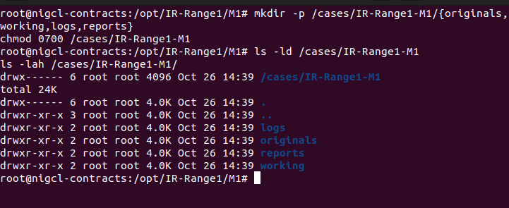
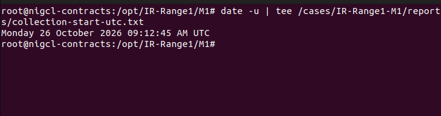
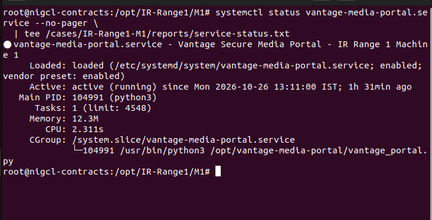
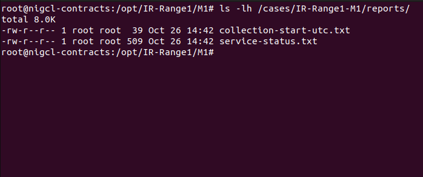

## 4. Initial detection and triage

Health endpoint returned `status: ok`, version `5.1`. `journalctl` returned no available journal files; investigation used application logs instead. The audit log recorded `authentication_success` and `asset_uploaded` for `maya.sen` at 2026-10-26T09:03:46Z. Access logs corroborated POST `/api/login` and POST `/api/upload` from `127.0.0.1` with user agent `VantageMediaDesktop/4.8.2`. Localhost is the simulator source because attack ran on the Ubuntu VM; separate Kali browser traffic should not be misattributed.

**Screenshot evidence:**

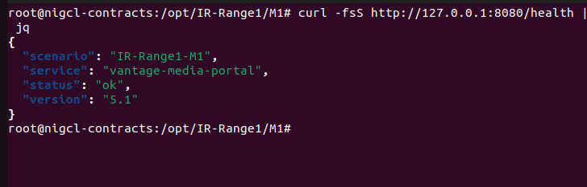
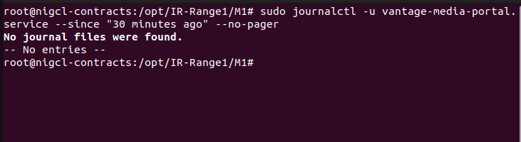
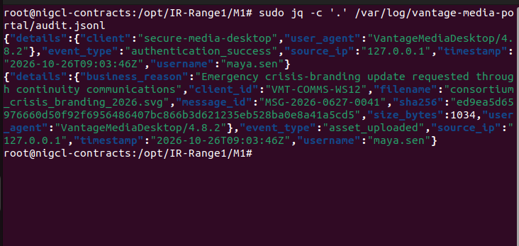
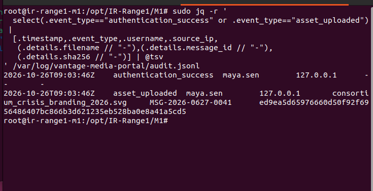
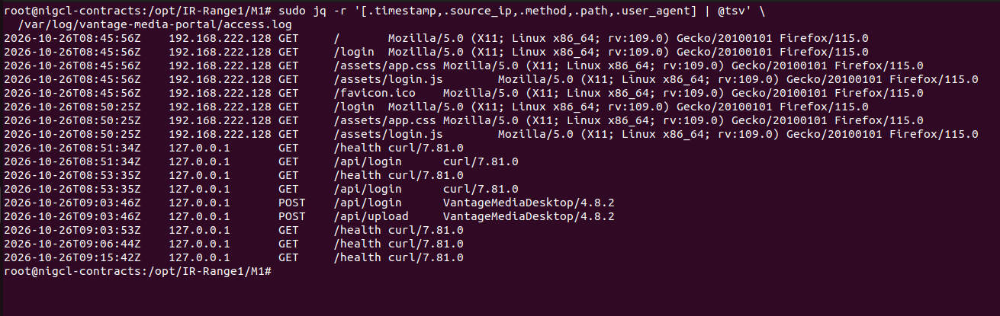

## 5. Evidence preservation and chain of custody

Copied communications, suspect/reference voice files, `audit.jsonl`, `access.log`, the portal SQLite database, and the SVG to the case directory. Created and refreshed a SHA-256 manifest. Ten archived evidence files later passed hash checks. The suspect SVG hash matched the portal event. Full chain-of-custody metadata (collector identity and transfer ledger) was not supplied.

**Screenshot evidence:**

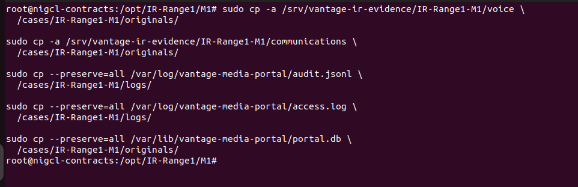
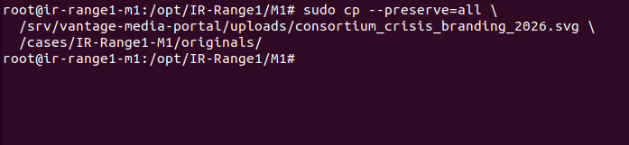
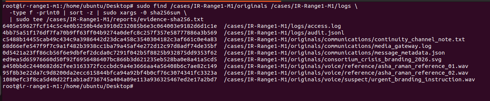
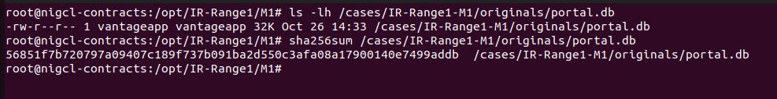

## 6. Communication context

`MSG-2026-0627-0041` was pre-staged at 2026-06-27T10:03:12Z, claimed sender Dr. Asha Raman, source `sip:continuity-chair@external-relay.invalid`, gateway `VMT-MGW-02`, attachment `urgent_branding_instruction.wav`, verification `pending`. The continuity policy requires independent callback and ticket approval for urgent publication and related actions. Voice alone was not an approval.

**Screenshot evidence:**

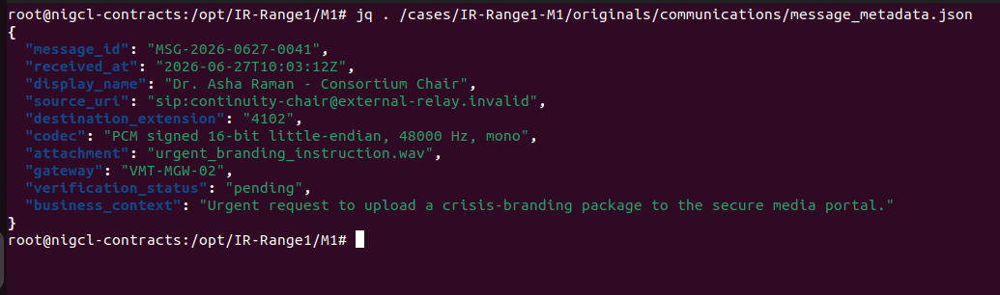
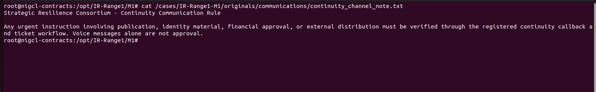
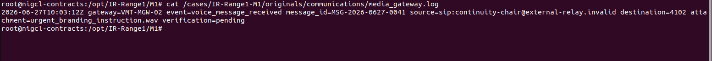

## 7. Audio forensics

Comparison of the suspect sample against two authorized samples yielded duration 11.852 s; reference centroid 895.29 Hz; suspect centroid 1835.98 Hz; shift 105.07%; high-band multiplier 15.62; peak anomaly 7420 Hz; `ANALYSIS_DECISION=LIKELY_SYNTHETIC`. Commands successfully generated suspect and reference spectrogram PNGs on the VM; actual spectrogram image files were not uploaded and are not included here. The method does not establish true sender identity.

**Screenshot evidence:**

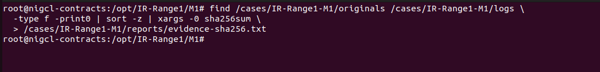
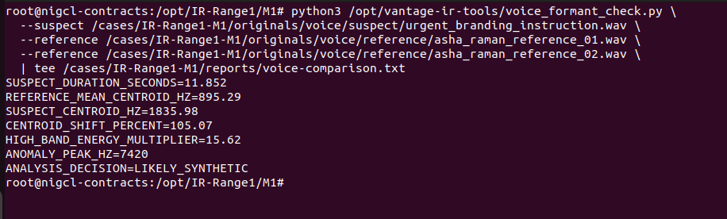
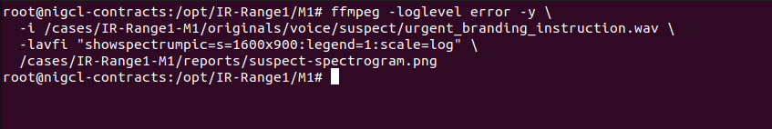
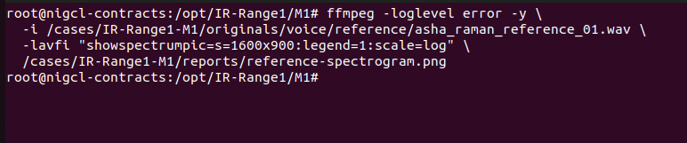
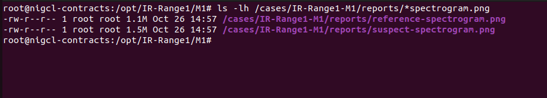

## 8. Portal and database forensics

SQLite uploads table contained upload ID 1; events table contained authentication event ID 5 and upload ID 6. Account `maya.sen`, source `127.0.0.1`, file `consortium_crisis_branding_2026.svg` (1034 bytes), message reference `MSG-2026-0627-0041`. Auditd key `ir_range1_m1_uploads` captured the portal Python process as `vantageapp`, `openat` file creation, success=yes, on 2026-10-26 at 14:33:46 IST.

**Screenshot evidence:**

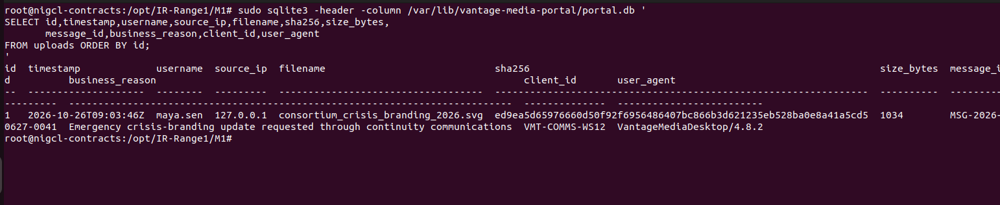
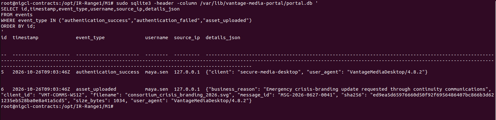
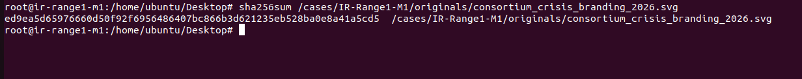
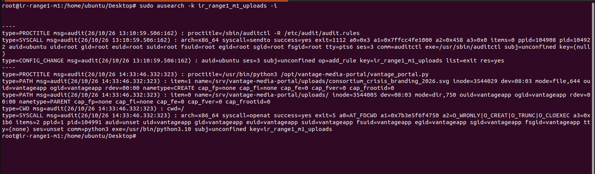

## 9. Timeline reconstruction

The combined timeline file was created. Pre-staged gateway message: 2026-06-27T10:03:12Z. Live simulator login and upload: 2026-10-26T09:03:46Z. Separate the seeded narrative date from actual test execution; order within the same-second portal events is corroborated by event IDs and request flow.

**Screenshot evidence:**

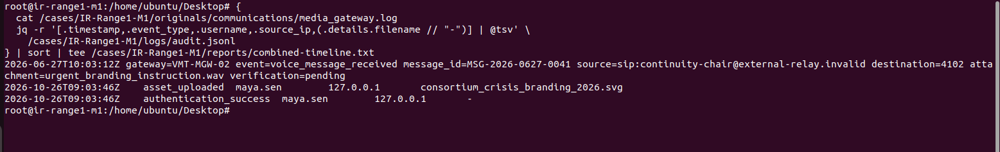

## 10. Scope determination

Observed one `maya.sen` login/session and one uploaded SVG linked to the local simulation source. Original session created 09:03:46Z, expiry 11:03:46Z, initially `revoked=0`. The source audit evidence contained one success and one upload; live uploads inventory contained one SVG. No additional compromised accounts were established from supplied evidence. Downstream rendering or later processing was not demonstrated.

**Screenshot evidence:**

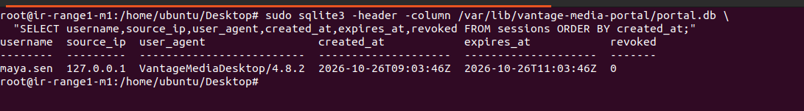
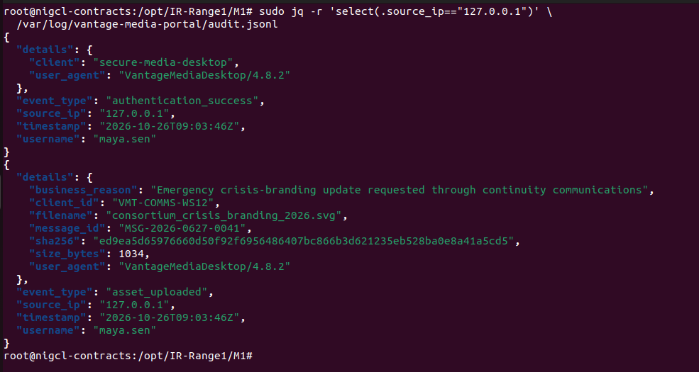
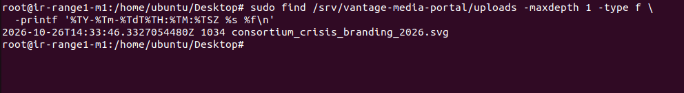

## 11. Containment

Executed `portal_admin.py disable-user maya.sen` and `revoke-sessions maya.sen`. User listing showed `maya.sen` enabled status `0`; database showed attack session `revoked=1`. The local loopback source `127.0.0.1` was not blocked, avoiding disruption of internal services.

**Screenshot evidence:**

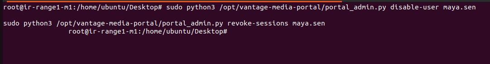
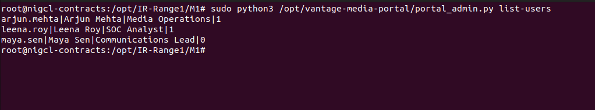
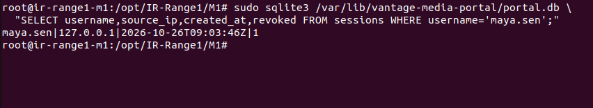

## 12. Eradication

Removed `consortium_crisis_branding_2026.svg` from live uploads after preservation. Rotated `maya.sen` password using portal administration tool; file inventory displayed expected portal program/static/database files. Preserved case copy retained. No claim of M2 renderer remediation is made.

**Screenshot evidence:**

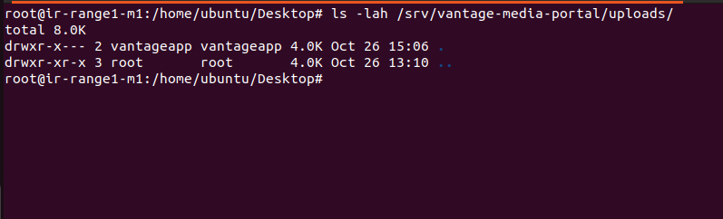
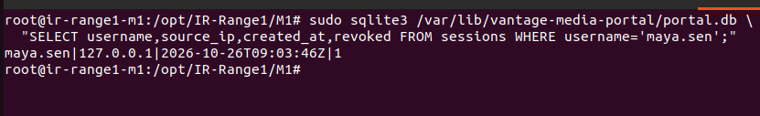
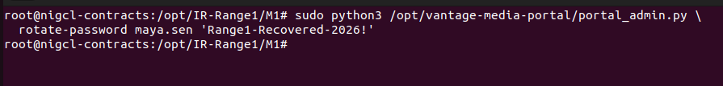
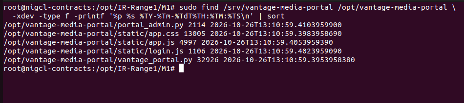

## 13. Recovery

Re-enabled `maya.sen`. Health endpoint returned `ok`, service `active`. Original simulator password was rejected HTTP 401; rotated lab password was accepted HTTP 200. The recovery login generated a separate session.

**Screenshot evidence:**

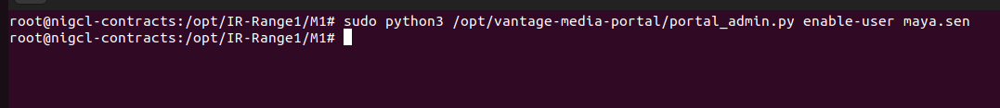
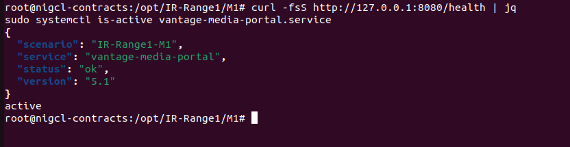
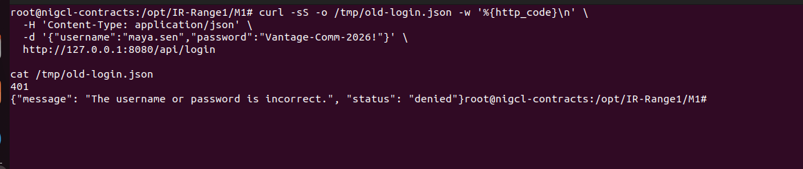
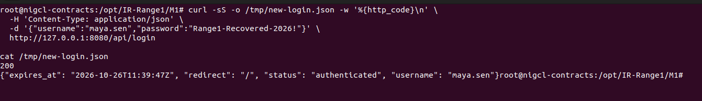

## 14. Recovery validation and monitoring

Uploads directory remained empty. All ten files in evidence manifest verified `OK` by SHA-256. Portal remained healthy. Original desktop session created 09:03:46Z was revoked (`1`); authorized recovery curl session created 09:39:47Z remained unrevoked (`0`). An initial verification query incorrectly selected a nonexistent `id` column and failed; the corrected official-column query succeeded. Continuous detection alerts were recommended but not configured or tested.

**Screenshot evidence:**

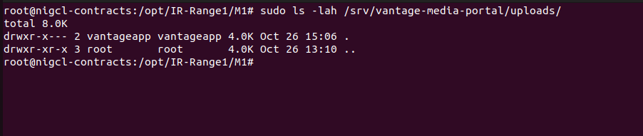
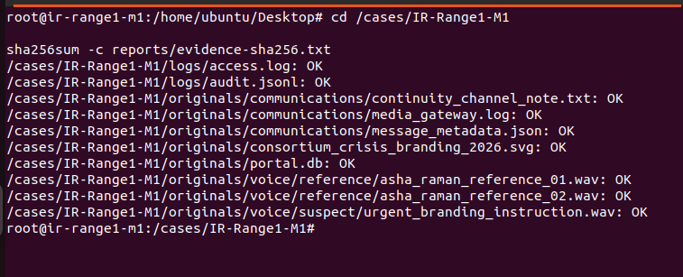
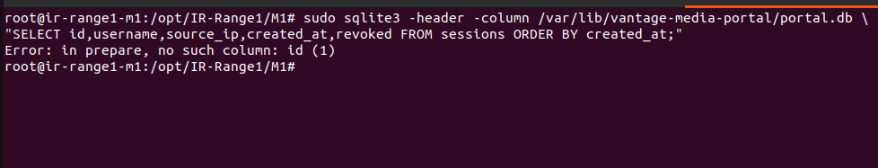
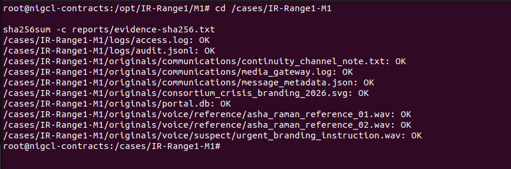
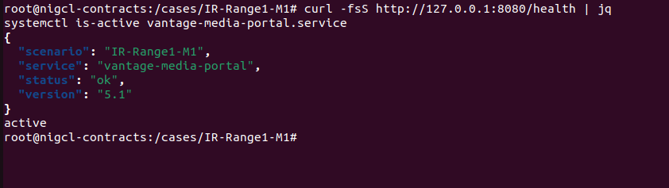
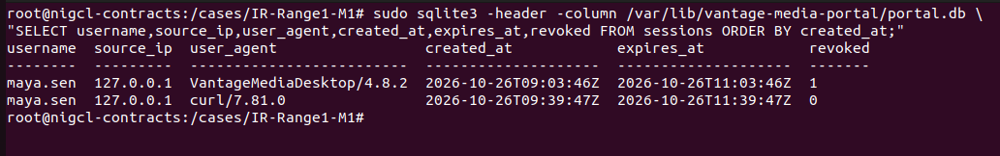

## 15. Final findings

Likely synthetic urgent-voice instruction, unverified claim of authority, unauthorized login/upload activity, preserved evidence integrity, and completed account containment and recovery. Impact demonstrated at M1 is unauthorized asset upload only; execution or rendering of the SVG was not tested on M1.

## 16. Lessons learned and recommendations

Require independently verified callback and continuity ticket for urgent media changes; gate publication on approved authorization; monitor unexpected login/upload correlations, unusual client IDs, and pending-verification communications; preserve original media, database, access/audit logs, and hash records. Alerts and new approval-enforcement controls are recommendations, not completed deployment.

## Key artifacts and checksums

- Uploaded SVG SHA-256: `ed9ea5d65976660d50f92f6956486407bc866b3d621235eb528ba0e8a41a5cd5`
- Preserved database SHA-256 (from screenshot): `56851f7b720797a09407c189f737b091ba2d550c3afa08a17900140e7499addb`
- Ten-item evidence manifest validated successfully on the VM. The original manifest and raw files have not been transferred into this archive.

## Limitations

- Screenshots demonstrate command output but are not substitutes for forensic originals.
- Portal review via the web interface was discussed, but portal page screenshots were not provided.
- Audio/spectrogram source files were generated or present on the VM but were not uploaded here.
- The earlier installer validator had been edited locally to correct its JSONL existence check; incident validation passed after that change.

## Source reference

Original instructor procedure: https://github.com/hacktifytechnologies/IR-Range1/blob/main/M1/Blue-Writeup.md
