# IR-Range1 M2: Poisoned Brand Asset
## Blue Team Incident Response Writeup

**Organization:** Vantage Media & Trust  
**Incident severity:** High  
**Host:** `ir-range1-m2` (Ubuntu 22.04.5 LTS)  
**Service:** `vantage-render-portal.service`  
**Renderer:** `VMT-RND-02`  
**Incident date:** 26 October 2026  
**Case location:** `/var/tmp/IR-Range1-M2-20261026T102227Z`  
**Status:** Investigation documented; live attack artifacts eradicated; portal recovered in paused rendering state; M3 handoff prepared, not yet transferred.

> **About this document:** Organized according to the official [M2 Blue Team Writeup](https://github.com/hacktifytechnologies/IR-Range1/blob/main/M2/Blue-Writeup.md). Findings are derived from the terminal screenshots and outputs supplied during the M2 walkthrough. Screenshots already supplied are included in `images/` and placed beside the relevant findings. Evidence notes identify dedicated captures that were not provided. Some additional forensic checks were performed outside the official sequence; these are labeled as supplemental.

## Executive Summary

On 26 October 2026, account `maya.sen` submitted the SVG `consortium_crisis_branding_2026.svg` to the Vantage Render Operations portal with emergency priority. Render job `RND-JOB-4417` on `VMT-RND-02` processed a local XML DTD, resolved an entity against a loopback metadata endpoint, wrote a 14,592-byte ELF executable as `.render-preflight`, and executed it under service account `vantage-render` (UID 998). Worker telemetry, auditd, a runtime marker, and a preserved database corroborate this chain. The suspicious SVG was quarantined, the active ELF and marker removed, and `maya.sen` disabled. The portal subsequently restarted with rendering still paused.

### Primary Indicators

| Indicator | Value |
|---|---|
| SVG | `consortium_crisis_branding_2026.svg` |
| SVG SHA-256 | `a3c741510ff71886bdc3e2c3ee7d4102d8ad4c3dc990300725de71bccbcd975e` |
| Asset ID | `AST-A3C741510FF7` |
| Business reference | `BRAND-EMG-0627` |
| Publisher account | `maya.sen` |
| Client ID | `VMT-COMMS-WS12` |
| Render job | `RND-JOB-4417` |
| Renderer | `VMT-RND-02` |
| ELF path | `/var/lib/vantage-render/workspaces/RND-JOB-4417/.render-preflight` |
| ELF SHA-256 | `8c7307d9cfd0c93ff88dc78fed58d46178e2050a88729810459d1784455ee8e3` |
| Execution account | `vantage-render` (UID 998) |
| Campaign marker | `MDRN-7F3A` |
| Internal metadata URL | `http://127.0.0.1:9091/v1/render-node/identity` |

---

## 1–3. Scenario Purpose, Learning Outcomes and Environment

The investigation addresses a poisoned brand SVG submitted through a trusted-looking emergency media workflow. The response objectives were to identify unauthorized processing, preserve forensic artifacts, reconstruct the attack, contain the affected service and identity, verify recovery, and prepare the M3 handoff. The staff portal used TCP 8081, and the metadata listener used loopback TCP 9091.

**Evidence limitation:** No dedicated screenshot was supplied for: Hostname, Ubuntu release, UTC time, and NTP status.

**Evidence limitation:** No dedicated screenshot was supplied for: Service user and 8081/9091 listening ports.

## 4. Preparation

The system was identified as Ubuntu 22.04.5 LTS on `ir-range1-m2`. The portal ran under `vantage-render`. The service exposed TCP 8081 for the staff portal while metadata was loopback-only on `127.0.0.1:9091`. Primary artifacts were identified under `/var/log/vantage-render`, `/var/lib/vantage-render`, and the SQLite `renderops.db` database.

## 5. Identification and Triage

Portal and renderer logs showed the successful `maya.sen` authentication, SVG upload, emergency render request, internal entity-resolution activity, ELF creation/execution, and job completion. The internal metadata-access log recorded `metadata_identity_requested` from `127.0.0.1` at `2026-10-26T10:00:47Z`, with user agent `Python-urllib/3.10`. `journalctl` returned no journal files, so structured application and auditd evidence were prioritized. The incident was classified **High severity**.

**Evidence limitation:** No dedicated screenshot was supplied for: Portal audit showing login, SVG upload, emergency render.

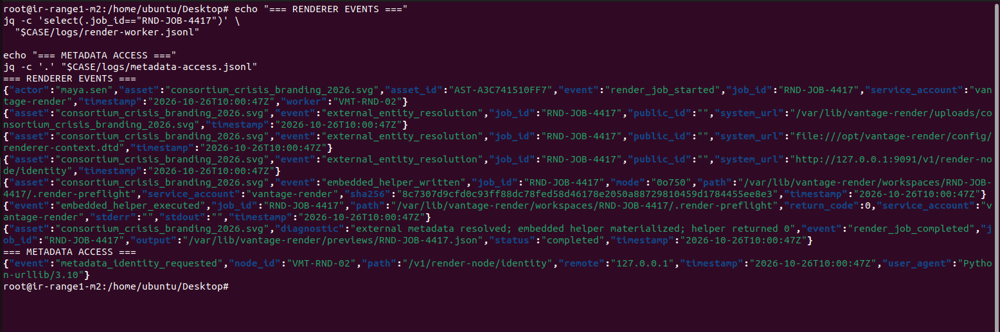

The renderer screenshot above also includes the internal metadata-access event.

## 6. Volatile Evidence Collection

A case directory was initialized at `/var/tmp/IR-Range1-M2-20261026T102227Z`, and acquisition began at **2026-10-26T10:26:44Z**. The collection included process listing/tree, renderer command line, `/proc` metadata, open descriptors, active sockets, IP configuration/routes, systemd service details, and auditd searches. Auditd keys `ir_r1_m2_asset_intake`, `ir_r1_m2_render_workspace`, and `ir_r1_m2_renderer_context` corroborated filesystem and execution activity. Journal collection was limited because journal files were unavailable.

**Evidence limitation:** No dedicated screenshot was supplied for: Process and service memory-mapping evidence.

**Evidence limitation:** No dedicated screenshot was supplied for: Auditd execve and file activity under vantage-render.

## 7. Persistent Evidence Acquisition

Portal/worker/metadata logs and audit results were copied into the case folder. A live-safe SQLite `.backup` of `renderops.db` returned `PRAGMA integrity_check = ok`. The submitted SVG, complete render workspace, configuration files, service unit, runtime marker, and preview were copied. SHA-256 manifests were generated and checked successfully. These verification steps demonstrate consistency with the manifest at verification time.

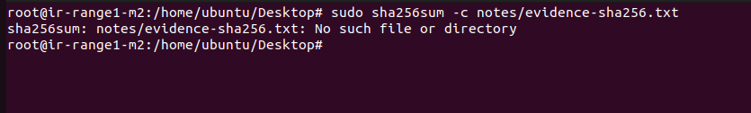

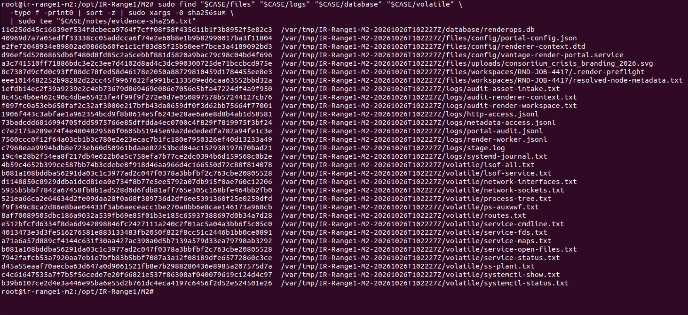

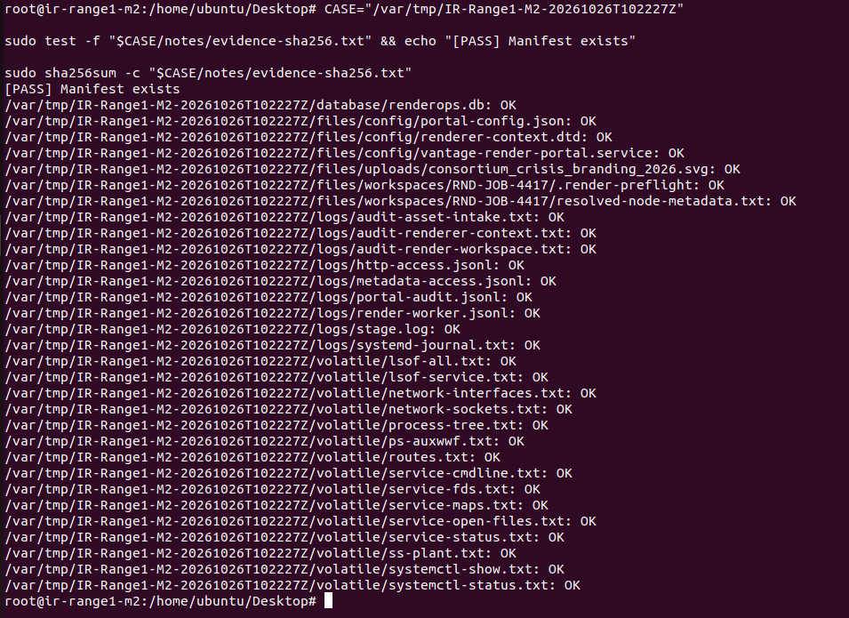

**Screenshot evidence:**

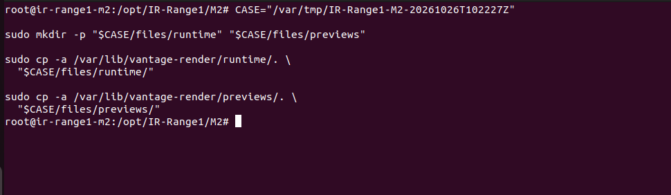

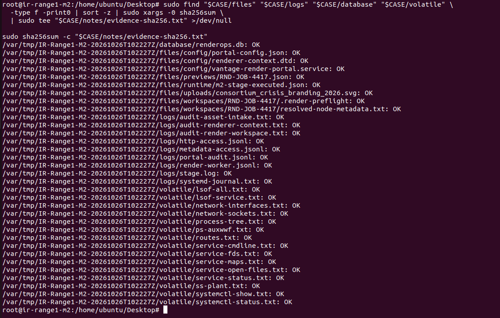

## 8. Containment

A root-owned investigation copy was retained before making changes to live paths. The `rendering.disabled` marker was created with owner `vantage-render` and mode `0640`. API health then returned `rendering_enabled: false` and renderer state `paused`. The portal service was stopped, leaving ports 8081 and 9091 no longer listening (verified at `2026-10-26T11:17:32Z`). Finally, `maya.sen` was disabled in the live SQLite database, confirmed by `maya.sen|0`. The screenshots establish a check time, not the exact moment the service was stopped.

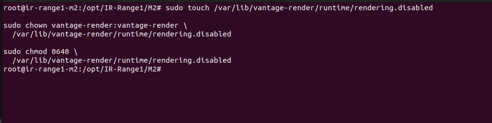

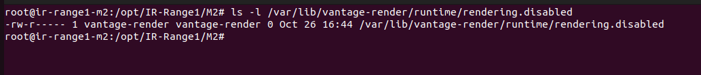

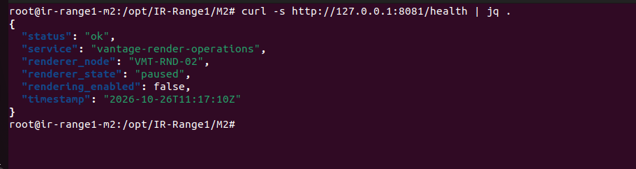

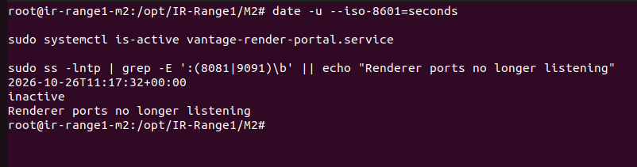

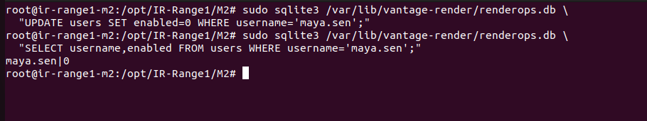

## 9. Portal and Database Forensics

The preserved `assets` table identified asset `AST-A3C741510FF7`, SHA-256 `a3c741...975e`, size **20,662 bytes**, uploaded by `maya.sen` from `127.0.0.1` with business reference `BRAND-EMG-0627`. The `render_jobs` record linked this asset to emergency job `RND-JOB-4417` on `VMT-RND-02`, status `completed`, timestamp `2026-10-26T10:00:47Z`, and diagnostic `external metadata resolved; embedded helper materialized; helper returned 0`. The `events` table contained earlier June baseline completions separate from the October incident.

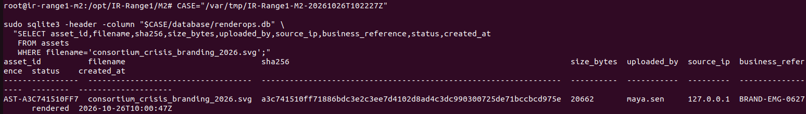

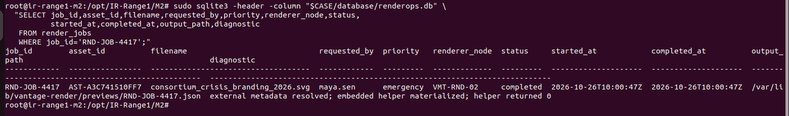

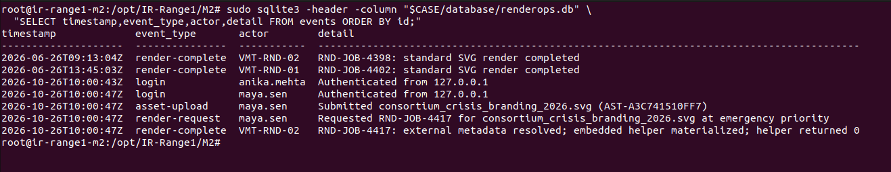

**Screenshot evidence:**

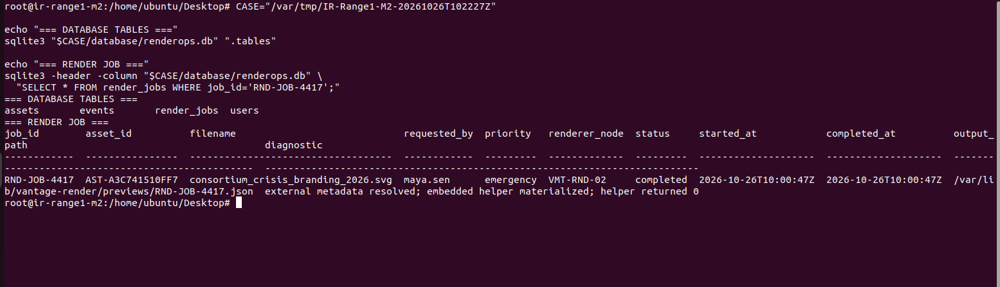

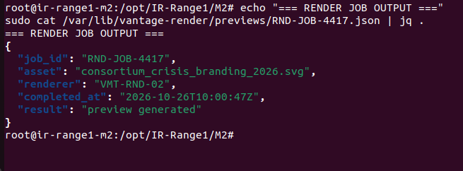

## 10. SVG and XML Entity Forensics

The preserved 20,662-byte SVG matched the recorded hash. Its `DOCTYPE` declared an external parameter entity with `SYSTEM` reference `file:///opt/vantage-render/config/renderer-context.dtd`. The DTD declared `nodeMetadata` referencing `http://127.0.0.1:9091/v1/render-node/identity` and `rendererProfile` as `VMT-PROD-LINUX`. The SVG embedded a package with request ID `BRAND-EMG-0627`, a `.render-preflight` write path, mode `0750`, `execute=true`, and Base64 content. Parsing the Base64 as text rather than evaluating XML entities safely yielded **14,592 bytes**. The extracted ELF SHA-256 matched the worker-materialized ELF: `8c7307d9cfd0c93ff88dc78fed58d46178e2050a88729810459d1784455ee8e3`.

The lab's successful processing depended on a compatibility DTD path created during setup troubleshooting. This was a training-environment adjustment, not a production remediation.

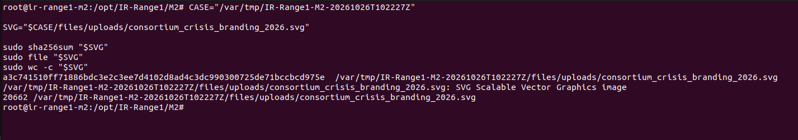

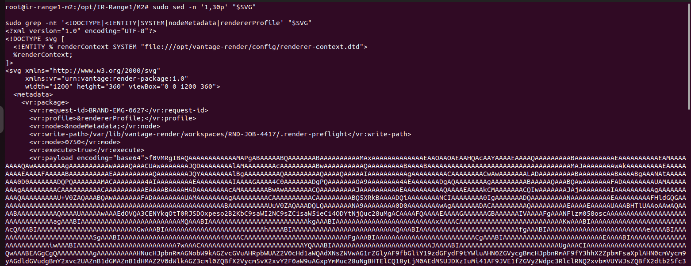

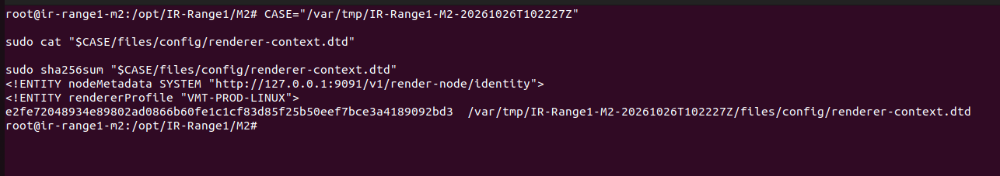

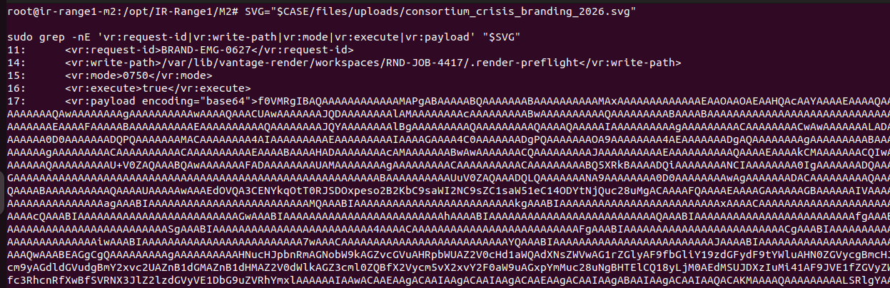

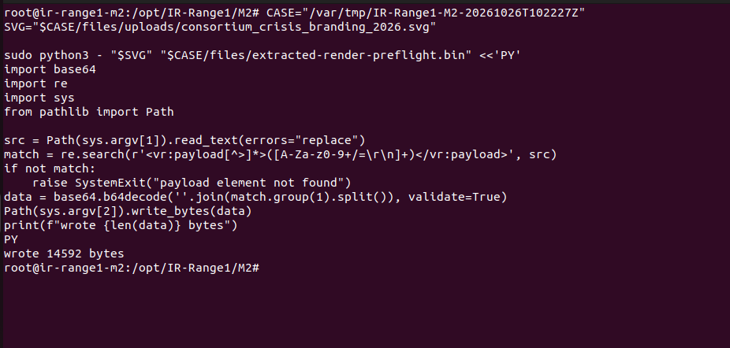

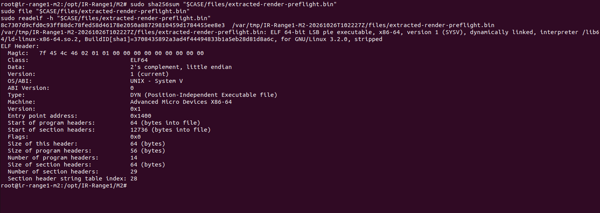

**Screenshot evidence:**

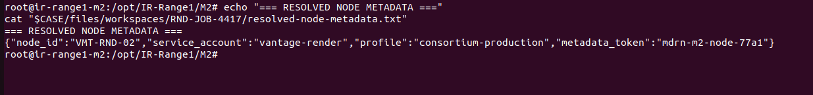

## 11. Materialized ELF Forensics

The workspace ELF was 14,592 bytes, mode `0750`, owned by `vantage-render` (UID 998). `readelf` identified an ELF64 x86-64 PIE, dynamically linked to `libc.so.6`, with entry point `0x1400`. The service unit declared `User=vantage-render`. Worker records showed `embedded_helper_executed`, return code `0`, and the runtime marker recorded `user=vantage-render`, UID 998, job `RND-JOB-4417`, and marker `MDRN-7F3A`. These form multiple lines of support for the claimed execution identity. Deeper malware behavior analysis remains for M3.

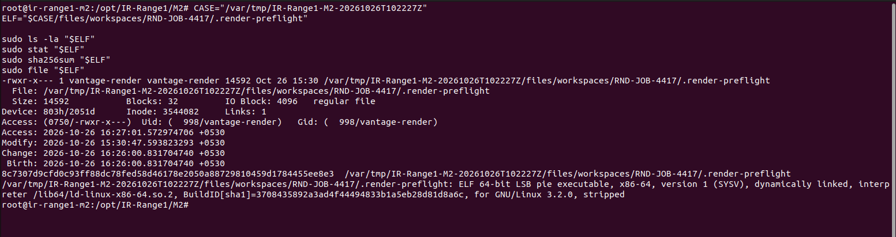

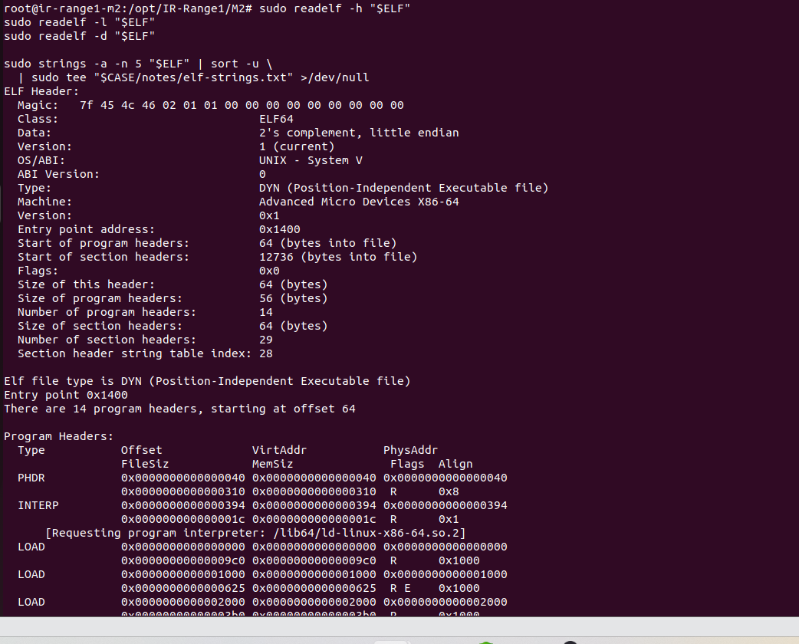

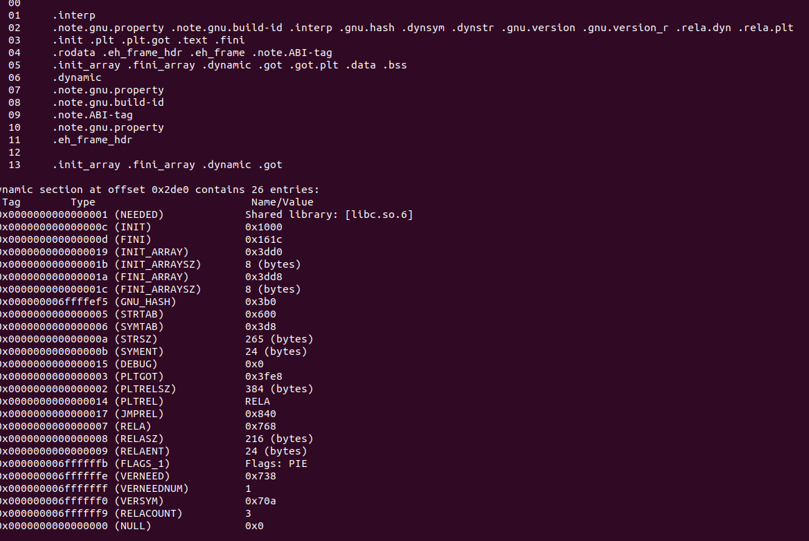

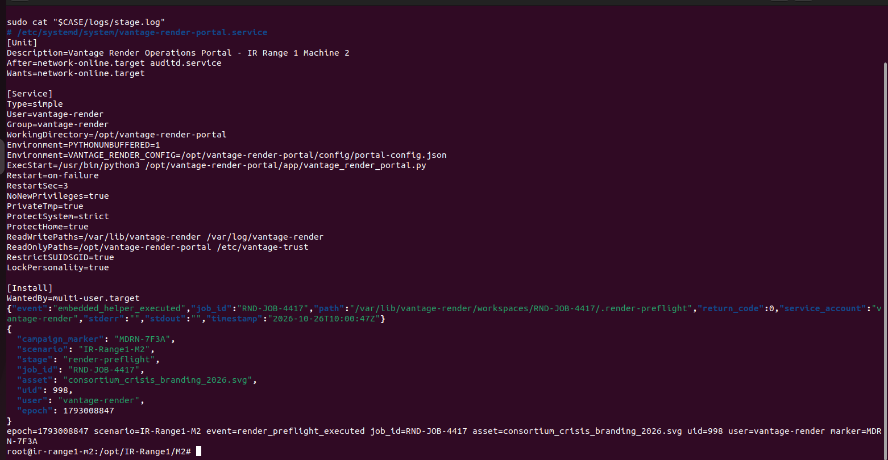

**Screenshot evidence:**

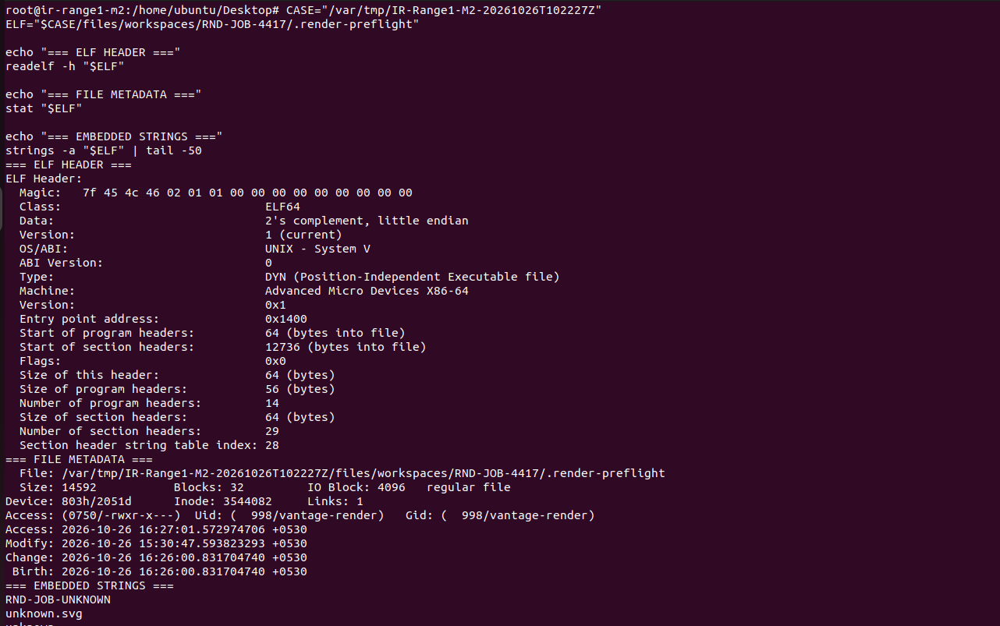

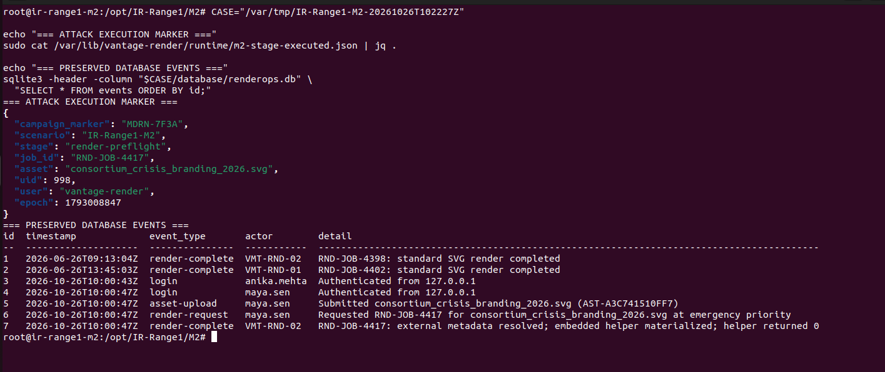

## 12. Timeline Reconstruction

| UTC timestamp | Event | Source |
|---|---|---|
| 2026-10-26 10:00:43 | `anika.mehta` authenticated for review | Database / portal audit |
| 2026-10-26 10:00:47 | `maya.sen` authenticated | Database / portal audit |
| 2026-10-26 10:00:47 | SVG uploaded and emergency render requested | Portal / database |
| 2026-10-26 10:00:47 | Render job started, external entities resolved, metadata accessed | Worker / metadata logs |
| 2026-10-26 10:00:47 | ELF written, executed, marker created; job completed | Worker / runtime / auditd |
| 2026-10-26 10:26:44 | Acquisition start documented | Case notes |
| 2026-10-26 11:17:32 | Service confirmed inactive after isolation | Terminal verification |
| 2026-10-26 12:09:56 | M3 handoff preparation documented | Custody notes |

Most attack events share a one-second timestamp. Their finer ordering derives from worker/log sequence, not from a simple lexical sort of the normalized TSV.

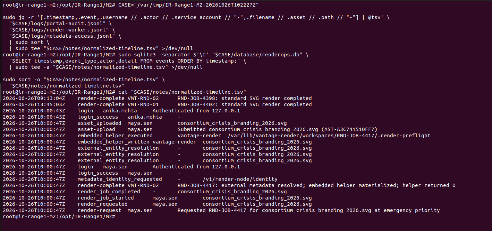

## 13. Root-Cause Analysis

The application accepted a document `DOCTYPE`, loaded a local DTD, and allowed external entity resolution. The local DTD provided access to internal identity metadata. In parallel, the renderer trusted user-controlled package instructions specifying executable output path, mode, and execution. Signing or independent authorization was not enforced for the emergency workflow, and a compromised publisher identity was still active on M2.

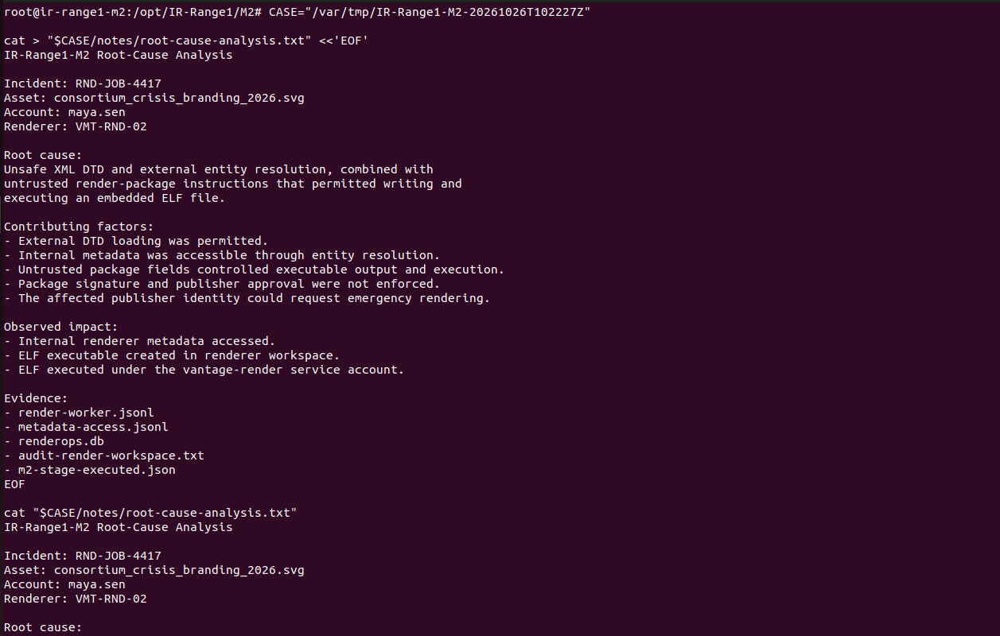

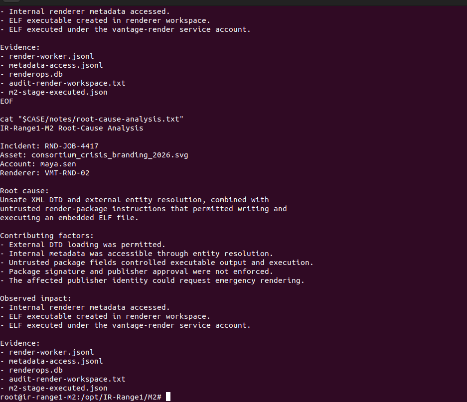

## 14. Scope Determination and Threat Hunting

Searches linked the suspicious filename, SVG hash, ELF hash, campaign marker `MDRN-7F3A`, account `maya.sen`, and client `VMT-COMMS-WS12` to the known job. The ELF hash was found in the active render workspace and two deliberately preserved forensic copies, not three distinct compromises. The initial package-field grep returned no matches due to mixed flags; the corrected search should use `grep -RnE` and needs confirmation before claiming that no other source SVG contains these fields. No additional affected node or identity was demonstrated by the available screenshots; the searched directories do not prove a full environment-wide absence.

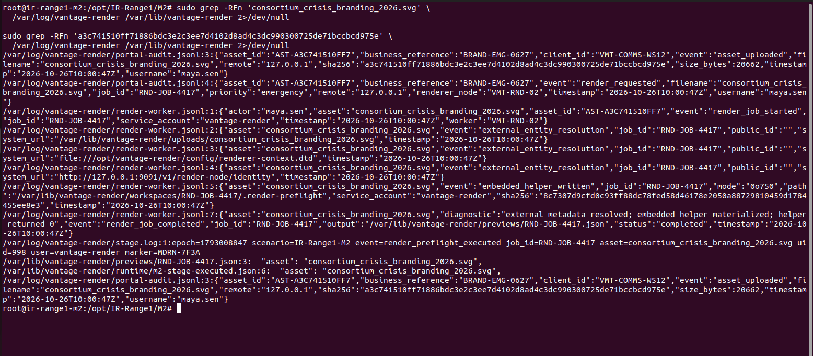

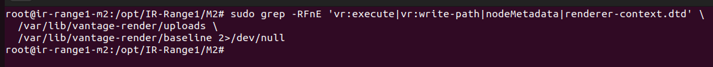

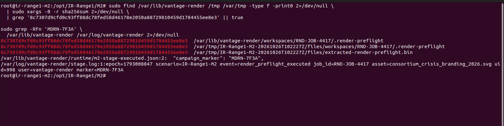

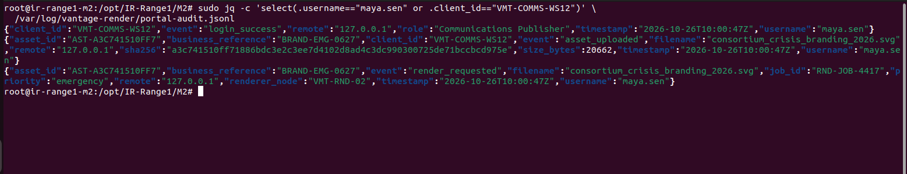

## 15. Eradication

The live workspace `.render-preflight` and runtime execution marker were removed, each followed by a successful absence check. The original SVG was moved from the active upload path to `/var/lib/vantage-render/quarantine`, given `root:root` ownership and mode `0600`; its SHA-256 continued to match the preserved evidence. Permanent fixes, including DTD/entity disablement, elimination of document-controlled executable operations, signing, sandboxing, and credential rotation, remain recommendations rather than implemented protections.

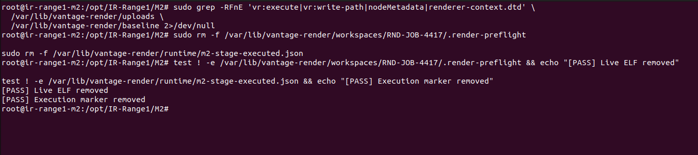

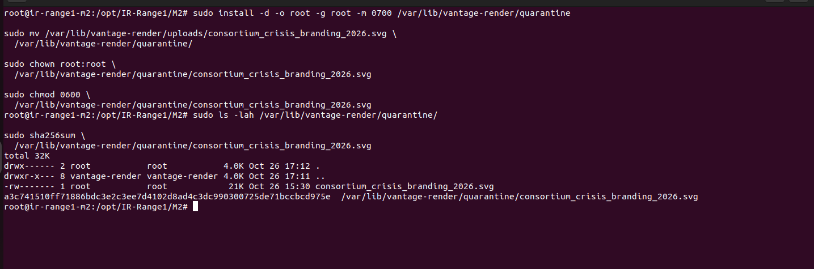

## 16. Recovery

All three live artifact absence checks passed. Authorized Blue Team user `anika.mehta` successfully authenticated and retrieved the dashboard. Renderer node `VMT-RND-02` remained paused. A subsequent health check reported active service, `status=ok`, `rendering_enabled=false`. Rendering was not resumed because permanent security corrections and approval were outstanding.

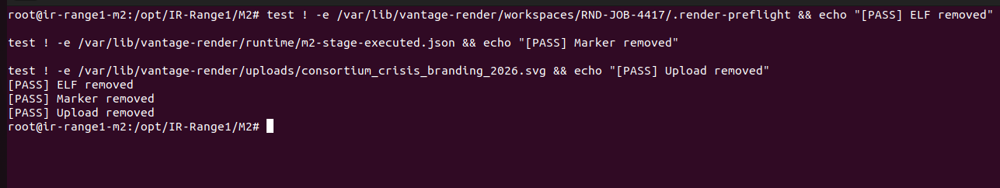

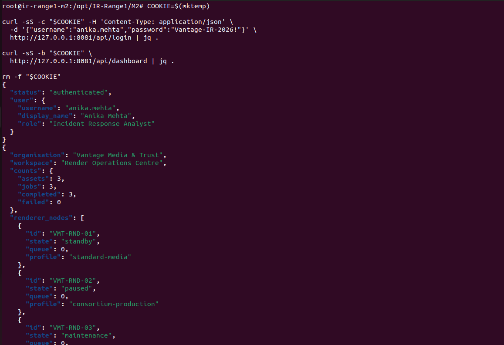

## 17. Recovery Validation Checklist

The observed recovery validation confirmed an active `vantage-render` service, `127.0.0.1:9091` restricted to loopback, 8081 listening, `maya.sen|0`, and the rendering pause retained. Evidence hashes passed earlier checks. A full multi-node ELF hunt and formal M3 transfer remain separate follow-up items.

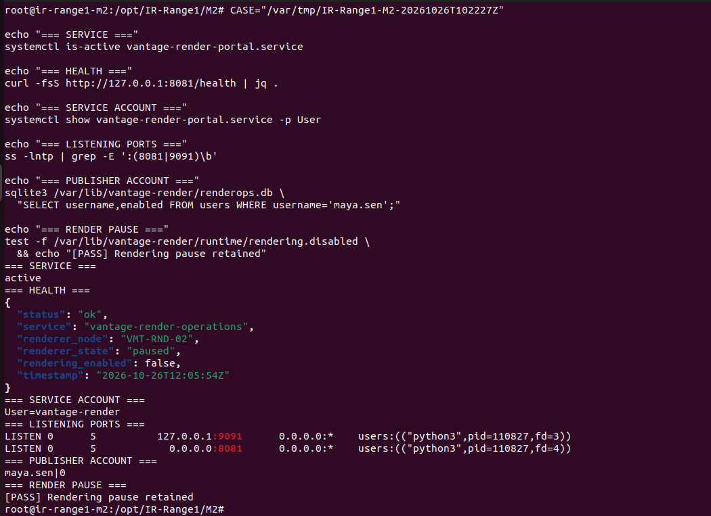

## 18. M3 Evidence Handoff

`M3-Handoff.txt` identifies the scenario, asset name/hash, job ID, renderer node, executable path/hash, execution account and campaign marker. The preserved SVG, extracted ELF, workspace ELF, SQLite database, logs, marker, normalized timeline, hashes and custody notes were inventoried. The chain-of-custody record listed collector `root`, acquisition start `2026-10-26T10:26:44Z`, handoff preparation `2026-10-26T12:09:56Z`, and explicitly stated that transfer had **not yet been performed**. Transfer must be documented upon actual delivery.

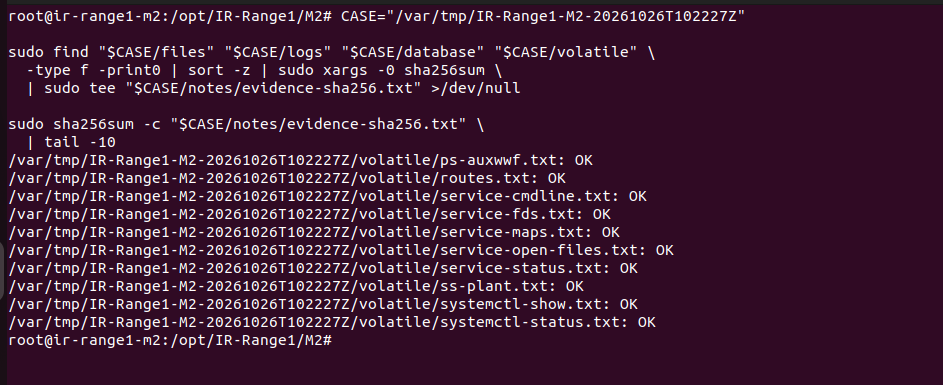

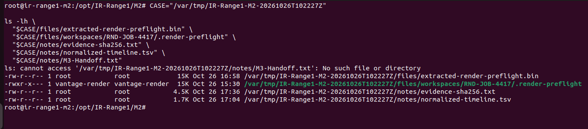

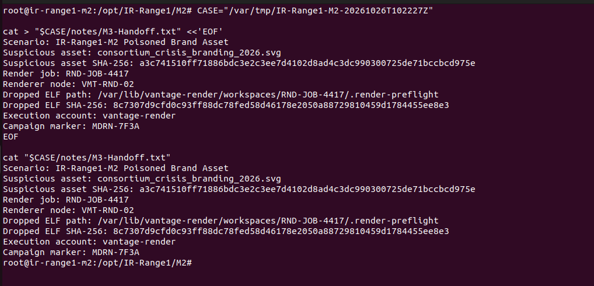

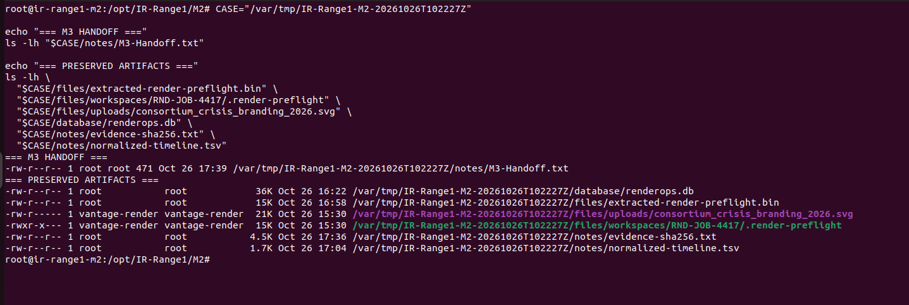

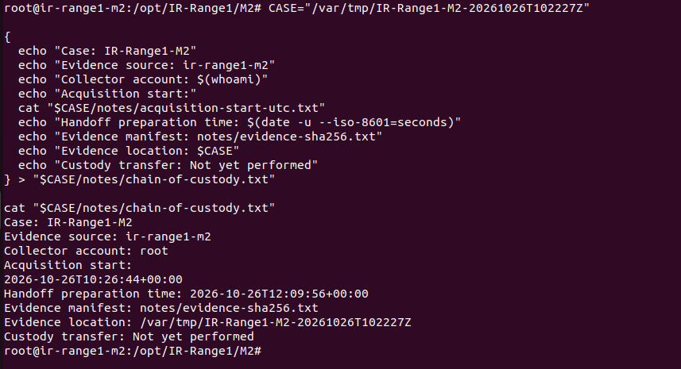

## 19. Lessons Learned

Recommendations documented in `lessons-learned.txt` include rejecting document-controlled executable creation, disabling DTDs and external entities, isolating the metadata service, dual authorization for emergency submissions, coordinated publisher revocation, review of other renderer nodes, SIEM forwarding, least-privilege filesystem controls, signed packages, sandboxing, immutable system images and controlled disclosure to NimbusSphere. The available evidence does not establish that these recommendations were implemented.

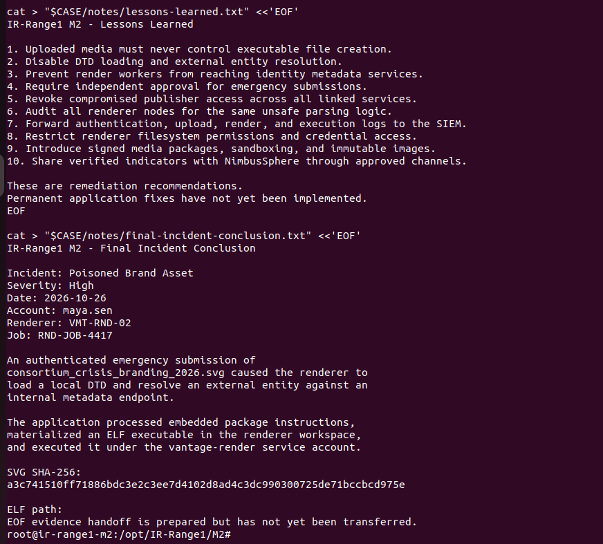

## 20. Final Incident Conclusion and Archive

The authenticated emergency SVG submission resulted in resolution of a local DTD and an internal metadata request, followed by materialization and execution of a matching ELF under `vantage-render`. Application logs, auditd, execution marker, preserved ELF, SQLite data and SHA-256 results mutually support the incident reconstruction. Containment and live-artifact eradication were completed. The portal recovered with rendering disabled. The vulnerable lab application was not permanently patched.

**Evidence archive created:** `/var/tmp/IR-Range1-M2-Evidence.tar.gz` (398 KB as displayed)  
**Archive SHA-256:** `968241f9e3e340ac700c9d3e3336782870ffdf348e334ea47bbbe29564aa5369`  
**External copy / transfer:** Not verified in supplied screenshots. Do not delete/reuse the VM until an off-VM copy is confirmed and its checksum validated.

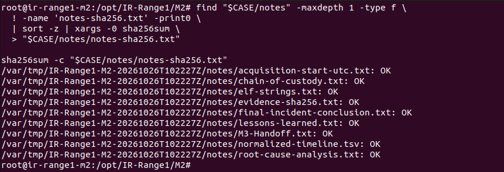

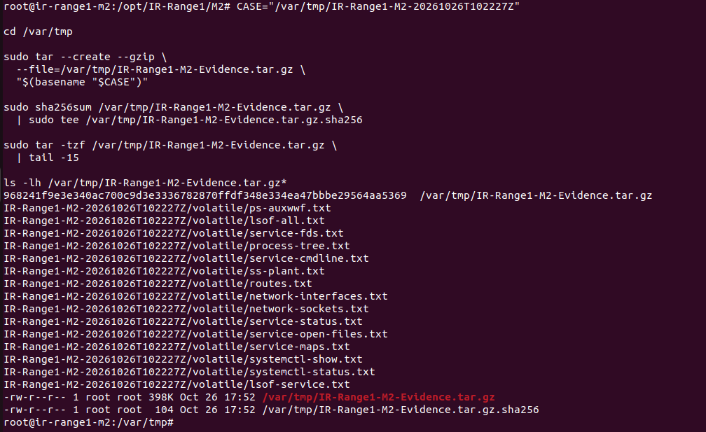

## Final Evidence Checklist

- [x] Relevant incident sources identified and acquired
- [x] Preserved database integrity checked
- [x] Original SVG hash and extracted/materialized ELF hashes correlated
- [x] Execution account and marker corroborated
- [x] Incident timeline and root-cause summary prepared
- [x] Publisher disabled; portal recovered with rendering paused
- [x] M3 handoff text and chain-of-custody record prepared
- [x] Case archive and checksum file created
- [ ] Archive copied outside the VM and copied hash independently verified
- [ ] Actual M3 custody transfer documented
- [ ] Permanent parser/render workflow fixes implemented and tested
- [ ] Corrected 14.2 baseline-wide grep recorded (optional completion item)

## Screenshot Conventions

The included screenshots are the supplied Ubuntu terminal captures. They are embedded beside the relevant findings with relative image paths. Dedicated captures that were not supplied are identified as evidence limitations.

**Source guide:** https://github.com/hacktifytechnologies/IR-Range1/blob/main/M2/Blue-Writeup.md
